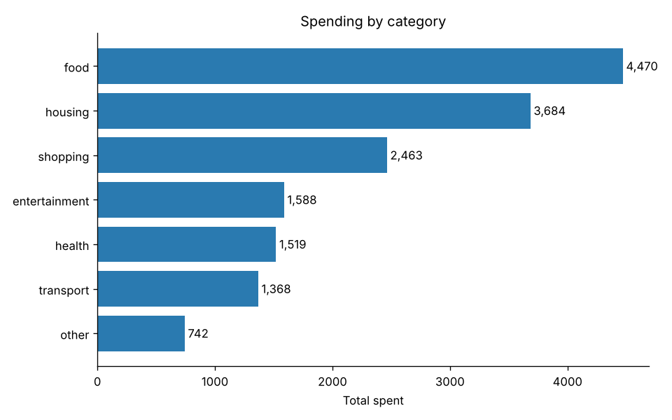
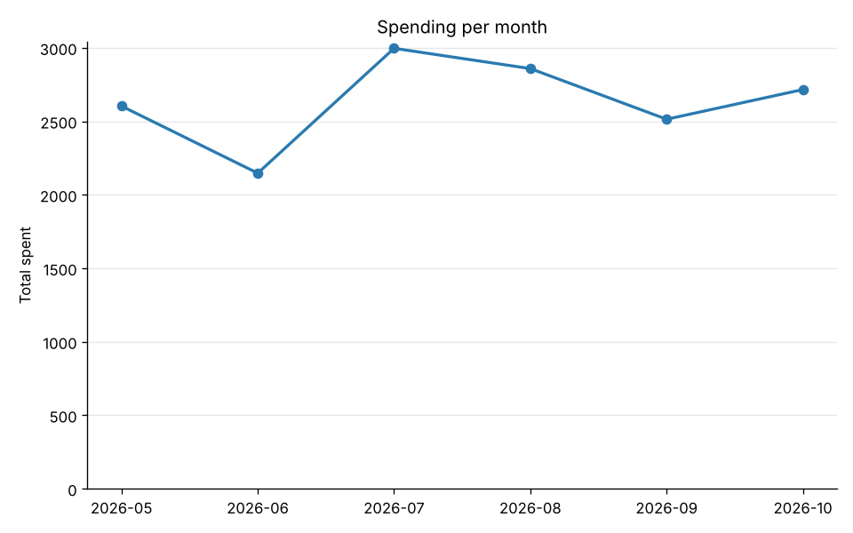

# Expense Tracker

A command-line app to record expenses, analyze spending with pandas, and
generate charts. Built in stages, growing into a web app with
machine-learning auto-categorization.




## Features
- Add expenses with amount, category, description and date
- List all expenses, newest first, with a running total
- Totals per category and per month
- Input validation (no crashes on bad input)
- Data saved to `expenses.csv`, so it survives restarts
- Analysis report with pandas: averages, share per category, month-over-month change, largest expenses
- Charts with matplotlib: by category, per month, by day of the week
- Realistic sample data generator for demos
- Unit tests with pytest

## How to run
Requires Python 3.10+.

```bash
pip install -r requirements.txt
python -m expense_tracker
```

Try it with demo data:
```bash
python -m expense_tracker.sample_data            # creates sample_expenses.csv
python -m expense_tracker --data sample_expenses.csv
```
Then choose **5** for the analysis report or **6** to save charts in `charts/`.

## Run the tests
```bash
pytest
```

## Project structure
```
expense_tracker/
  models.py    # Expense dataclass + validation
  storage.py   # CSVStorage: load/save expenses
  tracker.py   # ExpenseTracker: business logic (add, totals)
  analysis.py  # ExpenseAnalyzer: pandas analysis
  charts.py    # ChartMaker: matplotlib charts
  sample_data.py  # fake data generator for demos
  cli.py       # CLI: menu and user input
tests/
  test_tracker.py
  test_analysis.py
```

The logic (`tracker.py`) is separated from the interface (`cli.py`) and from
storage (`storage.py`), so the CLI can later be swapped for a web API and the
CSV file for a database without rewriting the core.

## Roadmap
- [x] Stage 1: CLI + CSV storage + tests
- [x] Stage 2: Data analysis with pandas + charts
- [ ] Stage 3: REST API with FastAPI + database
- [ ] Stage 4: ML model to auto-categorize expenses
- [ ] Stage 5: React frontend + deployment
